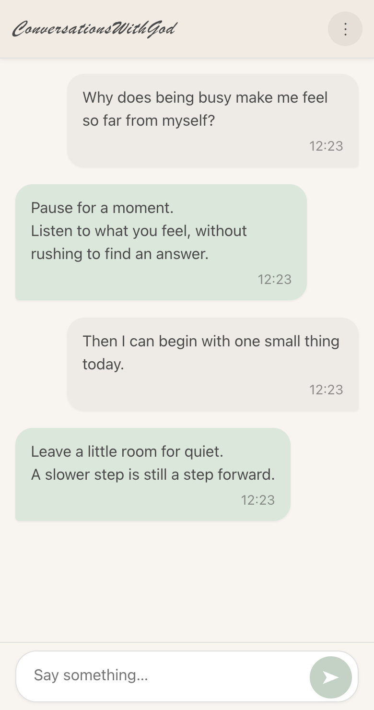
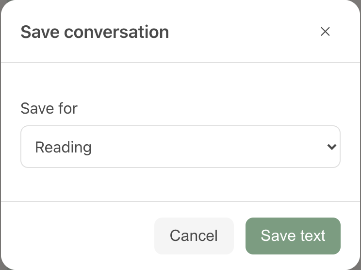

  

<h1 align="center">ConversationsWithGod</h1>

Talk with yourself. Make room for an inner reply.

<a href="README.md">中文</a> · <b>English</b>

<a href="https://studentiz.github.io/ConversationsWithGod/">Begin a conversation →</a>

ConversationsWithGod is a quiet space for self-dialogue. On the right, write a question, a feeling or a thought. On the left, take another perspective and answer with your own inner wisdom.

You write both sides. “God” can mean the divine, your higher self, or simply a clearer, kinder voice within. Give that voice a little room; an answer does not have to arrive immediately.

  

## Getting started

Open the [web app](https://studentiz.github.io/ConversationsWithGod/) and write your first message. The two voices alternate after each send.

- **Enter** sends; **Shift + Enter** adds a line. On a phone, tap the send button.
- The menu adjusts text size, switches light and dark appearance, exports or clears your conversation.
- You have five seconds to undo a deletion or a cleared conversation.
- The interface follows your browser language, in Chinese or English.

The first visit loads the page; afterward, it can reopen offline. You can also download [index.html](index.html) and open it directly in a browser.

## Stay with the moment

Paper, warm grey questions and sage green replies place the visual focus on the left. Text appears in full, with a gentle upward movement when you send. A translucent scroll indicator appears while scrolling and slowly fades afterward. Multiline drafts have no visible scrollbar.

Older messages gradually fade and blur, like memories receding into the background. Text and timestamps age together; the originals remain saved and exportable. Fading is a display effect, not encryption or deletion.

Long conversations render only the area near the screen while keeping the full history continuously accessible. The interface respects the system’s reduced-motion preference.

## Save or continue a conversation

“Export conversation” starts with readable text. Other options appear when you choose a different purpose.

  

| Purpose | Files |
| --- | --- |
| Reading | Plain text |
| Backup | Complete JSON with original text, roles and timestamps |
| Continuing with AI | Portable messages history; OpenAI / DeepSeek / Qwen Chat Completions, OpenAI Responses, Claude Messages and Gemini API requests |
| Fine-tuning | OpenAI, Hugging Face / TRL and ShareGPT JSONL examples |
| Other formats | ShareGPT JSON, Alpaca JSON, legacy Claude text and Llama 2 INST |

Files are generated on your device. You can use them in a model tool yourself; this app does not call model APIs. See the [export guide](docs/EXPORTS.md) for formats and training examples.

## Your conversation stays with you

Conversations are saved in the current browser. There are no accounts, synchronization, analytics or services that upload your dialogue. Clearing browser data can remove your history; export a backup for anything you want to keep.

## Contributing

Issues, suggestions and contributions are welcome. See the [development guide](docs/DEVELOPMENT.md) and [validation record](docs/VALIDATION.md).

If this small space helps you, feel free to share it with someone who could use it.
