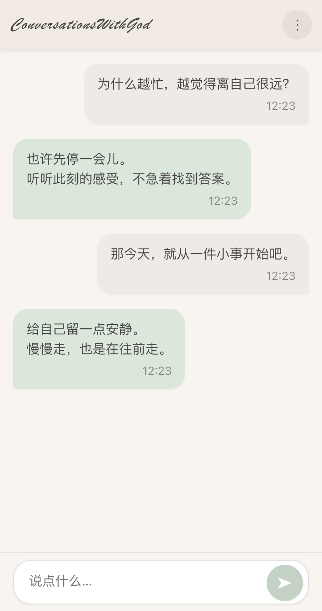
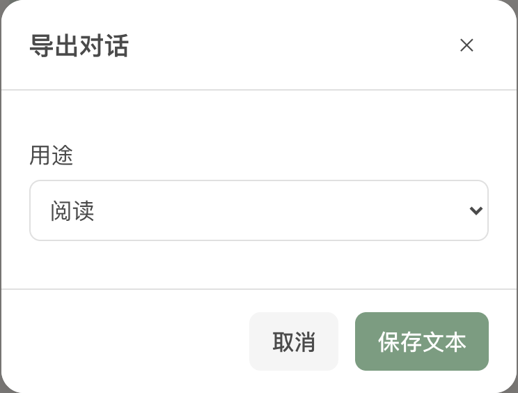

  

<h1 align="center">ConversationsWithGod</h1>

和自己说说话，听见内心的回应。

<b>中文</b> · <a href="README.en.md">English</a>

<a href="https://studentiz.github.io/ConversationsWithGod/">开始对话 →</a>

ConversationsWithGod 是一个安静的自我对话空间。右侧写下你的困惑、念头和提问；左侧，换一个角度，用自己的内在智慧回应。

你扮演对话中的双方。这里的“God”可以是你理解的神、理想中的自己，或心底那个更清醒、更温柔的声音。留一点时间给它，答案不必马上出现。

  

## 开始使用

打开 [网页版](https://studentiz.github.io/ConversationsWithGod/)，写下第一句话即可。每次发送后，角色自动交替。

- **Enter** 发送，**Shift + Enter** 换行；手机上也可以点发送按钮。
- 右上角菜单可以调整字号、切换深浅外观、导出或清空对话。
- 删除一条对话或清空后，5 秒内可以撤销。
- 界面跟随浏览器语言显示中文或英文。

首次访问需要加载网页，之后支持离线打开。也可以下载仓库里的 [index.html](index.html)，直接用浏览器打开。

## 留在当下

纸色背景、暖灰色提问和绿色回应，让目光自然落在左侧。文字完整显示，发送时气泡轻轻上移。滚动指示条在滚动时出现，停下后慢慢淡出；输入框支持换行，也不会露出突兀的滚动条。

较早的对话会逐渐淡化、模糊，像记忆一样退到背景中。文字与时间一起变化；原文仍保留，可以完整导出。淡化是显示效果，并非加密或删除。

长对话只渲染屏幕附近的内容，完整历史仍可连续浏览。开启系统的“减少动态效果”后，界面会减少动画。

## 保存与继续对话

“导出对话”默认保存便于阅读的文本。选择其他用途时，才会出现相应的选项。

  

| 用途 | 可选文件 |
| --- | --- |
| 阅读 | 纯文本 |
| 备份 | 包含原始内容、角色和时间的完整 JSON |
| 交给 AI 继续对话 | 通用 messages 历史；OpenAI / DeepSeek / Qwen Chat Completions、OpenAI Responses、Claude Messages、Gemini API 请求 |
| 微调模型 | OpenAI、Hugging Face / TRL、ShareGPT 的 JSONL 训练样本 |
| 其他格式 | ShareGPT JSON、Alpaca JSON、旧版 Claude 文本与 Llama 2 INST |

文件在设备上生成。你可以自行将它交给模型工具；本应用不调用模型 API。具体格式与训练样本的说明见 [导出指南](docs/EXPORTS.md)。

## 对话留在你的设备上

对话保存在当前浏览器中，没有账号、同步、分析追踪或上传对话的服务。清理浏览器数据可能会移除历史；需要长期留存的内容，可以导出备份。

## 参与项目

欢迎提出问题、改进建议或贡献代码。构建与验证方式见 [开发说明](docs/DEVELOPMENT.md)，已有检查见 [验证记录](docs/VALIDATION.md)。

如果这个小空间对你有所帮助，也欢迎把它分享给需要的人。
